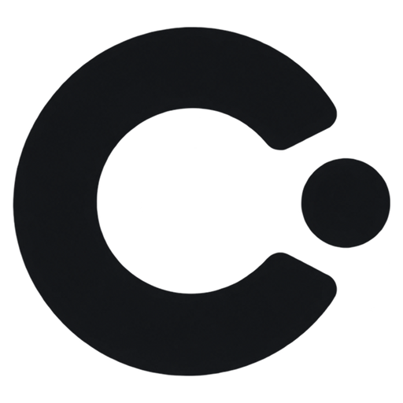

<div align="center">



# Cue

**Every keystroke and gesture, on center stage.**  
*Ultra-fast, tactile, distraction-free stage visualizer for presentations and screencasts.*

[](https://github.com/yviscool/cue/actions/workflows/ci.yml)
[](https://golang.org)
[-0078D6?style=flat-square&logo=windows)](https://microsoft.com/windows)
[](https://github.com/yviscool/cue/releases)
[](LICENSE)

[English](README.md) · [简体中文](README_zh.md) · [繁體中文](docs/README_zh-TW.md) · [日本語](docs/README_ja.md)

</div>

---

## What is Cue?

**Cue** is a modern, high-performance keystroke and gesture visualization tool built from scratch in **Pure Go (Zero CGO)** and powered directly by **Direct3D 11 GPU hardware acceleration**.

Engineered for tech speakers, educators, live streamers, and screencasters, Cue bridges the gap between your physical keyboard/mouse and your audience's eyes. It renders physical keystrokes, semantic shortcut actions, and mouse interactions into fluid, crystal-clear visual cues—completely distraction-free, zero frame tearing, and without ever stealing window focus.

---

## Key Highlights

- ⚡ **Pure Go Runtime (Zero CGO)**: Standalone single-binary distribution (< 12 MB) with zero external DLL dependencies. Sub-millisecond startup and microscopic memory footprint.
- 🎮 **Direct3D 11 GPU Direct Rendering**: Hardware-pipelined drawing at full monitor refresh rates (60Hz / 120Hz / 144Hz+). Truly transparent, borderless overlay that passes clicks through seamlessly.
- 🎨 **19 Curated Keyboard Themes**:
  - *Liquid Glass* (visionOS-inspired frosted refractive translucent glass)
  - *MacBook Scissor* (Apple Space Gray anodized aluminum aesthetic)
  - *Dieter Rams 1960* (Braun warm putty gray with iconic safety orange)
  - *Cyberpunk Neon* (High-contrast cyan & magenta neon pulse)
  - *Azure Pulse* (Deep navy plate with modifier keys glowing in the same azure as the letter keys)
  - *Classic Mechanical* (PBT double-shot keycaps)
  - *IBM Model M 1984* (Industrial retro buckling spring)
  - *Sony Walkman 1979* (Brushed silver-blue metal with cassette-deck acrylic)
  - *Minimal Chalk*, *Obsidian OLED*, *Tokyo Blossom*, *Emerald Matrix*, *Sunset Horizon*, *Royal Velvet*, *Teenage OP-1*, *Amber Cathode 1977*, *Swiss Typography 1957*, *Kyoto Kintsugi*, *Blueprint Cyanotype*
- 🖱️ **6 Companion Mouse Themes (New in v1.1.0)**:
  - *Neon Green*, *Aurora Dual-Tone*, *Cyber Cyan*, *Obsidian Crimson*, *Deep Space Blue*, *Minimal White*
  - Color-coded left, right, and middle click lobes with companion cursor rings.
- 🎯 **Retina Multi-Click Badges**:
  - Automatically anchors streak badges (`×2`, `×3`) directly to the physical button lobe being clicked.
  - Multi-click badges stay on stage for 1.2s for optimal audience perception, while button click highlights dim dynamically.
- 🧭 **Refined Directional Scroll Arrows**:
  - Sleek, high-contrast directional chevrons inside the mouse wheel slot indicate scroll up/down directions with perfect breathing room.
- 🧠 **Context-Aware Semantic Action Recognition**:
  - Automatically identifies universal shortcuts and displays human-readable intent subtitles (e.g., `Ctrl + C` $\rightarrow$ *Copy*, `Alt + Tab` $\rightarrow$ *Switch Window*, `Ctrl + Z` $\rightarrow$ *Undo*).
  - Detects the foreground application and adapts the meaning: **VS Code**, **JetBrains**, **Visual Studio**, **Dev-C++**, **IDLE**, browsers, terminals, Office, Figma, Slack, and more.
  - Supports two-chord sequences (`Ctrl + K` `Ctrl + S` $\rightarrow$ *Save All*), an optional application badge, and user overrides in `config.json`.
  - Resolution is cached per foreground change, so the hook path stays allocation-free and the FPS never drops.
- 🔤 **Alphanumeric Word Grouping & Backspace Absorption**:
  - Seamlessly combines character strokes into readable words; pressing Backspace automatically trims trailing characters in real time.
- 🔊 **Keystroke Audio & Spatial Panning (New in v1.2.0)**:
  - Low-latency polyphonic mixing engine for rapid keystroke playback.
  - 5 sound profiles: *Thock* (mechanical), *Click* (tactile), *Scissor* (laptop), *Glass* (chime), and *Typewriter*, supporting automatic theme matching and manual selection.
  - Stereo panning based on physical key horizontal positions with micro-pitch dynamics.
- 🎚️ **Live Presentation Controls (New in v1.3.0)**:
  - Independent opacity sliders for the keycap overlay and the mouse overlay, so the cursor ring can sit fainter than the keycaps next to it.
  - Master keystroke volume slider, applied as gain at mix time so dragging it responds instantly without re-rendering a single sample.
- 📚 **Expanded Shortcut Vocabulary**:
  - 1061 mappings across 25+ application profiles and 120 category defaults, 707 distinct action intents, zero duplicate chords.
  - Shifted-symbol canonicalisation: `Ctrl + !`, `Ctrl + Shift + 1` and `Ctrl + Shift + Exclamation` all resolve to the same chord.
  - A generated reference table lives at `docs/shortcut-reference.md` and is verified by test.
- 📍 **Dual-Mode 9-Grid Screen Positioning**:
  - Tactile 3×3 edge matrix paired with an interactive 16:10 desktop mini-map for pixel-perfect margin adjustments.
- 🔒 **Privacy Shield**:
  - Automatically detects sensitive password inputs and masks private keys with `[🔒 Private]`.
- 🌐 **Native 4-Language Switching**:
  - Instant live locale toggle across English, 简体中文, 繁體中文, and 日本語.

---

## Quick Start

### 1. Download Prebuilt Binary
Grab the latest release `cue.exe` directly from the [GitHub Releases](https://github.com/yviscool/cue/releases) page.
Single file, portable, zero installation needed.

### 2. Build from Source
Requirements: Go 1.23+ and a Windows 10/11 environment.

```powershell
# Clone the repository
git clone https://github.com/yviscool/cue.git
cd cue

# Run test suite
go test -v -count=1 ./...

# Build optimized production binary
go build -ldflags="-H windowsgui -s -w" -o cue.exe .
```

### 3. Usage & Hotkeys
- **Toggle Overlay Visibility**: Press `Shift + F10` (customizable in Settings).
- **Settings Studio**: Left-click or right-click the Cue tray icon and select **Settings** to customize themes, positions, and mouse behaviors.

---

## Documentation

- [System Architecture](docs/architecture.md) — Deep dive into Pure Go D3D11 rendering, OS hooks, and the decay state machine.
- [Configuration Reference](docs/configuration.md) — Comprehensive schema for `%APPDATA%\Cue\config.json`.
- [Themes & Customization](docs/themes.md) — Visual breakdowns of the 12 keyboard themes and 6 mouse presets.
- [Shortcuts & Actions](docs/shortcuts.md) — Universal shortcut decoders and Privacy Shield guidelines.

---

## Contributing

Contributions, bug reports, and design suggestions are warmly welcome! Please open an issue or submit a pull request on GitHub.

```powershell
# Verify formatting and tests before submitting
go vet ./...
go test -count=1 ./...
```

---

## License

Cue is open-source software licensed under the [MIT License](LICENSE).
