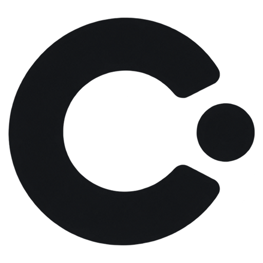

<div align="center">



# Cue

**极简高质感按键与手势舞台提示工具，让每一次敲击与手势都清晰可见。**  
*专为演讲演示、教学培训、技术直播与录屏打造的高刷新、无焦点夺取视觉信号系统。*

[](https://github.com/yviscool/cue/actions/workflows/ci.yml)
[](https://golang.org)
[-0078D6?style=flat-square&logo=windows)](https://microsoft.com/windows)
[](https://github.com/yviscool/cue/releases)
[](LICENSE)

[English](README.md) · [简体中文](README_zh.md) · [繁體中文](docs/README_zh-TW.md) · [日本語](docs/README_ja.md)

</div>

---

## 品牌理念

**Cue** —— 提示、信号、舞台提示。

在现场演讲、编程教学与技术演示中，操作者行云流水的高频快捷键常常让屏幕前的观众眼花缭乱。**Cue** 基于纯粹的 **Pure Go (Zero CGO)** 原生架构与 **Direct3D 11 GPU 硬件加速**，以极致的视觉审美标准重新定义按键可视化工具。

它不夺取任何焦点，不产生任何卡顿，完全穿透鼠标点击，将物理敲击与鼠标动作化作舞台上利落、灵动的高质感信号。

---

## 核心亮点

- ⚡ **原生 Pure Go 直驱 (Zero CGO)**：纯 Go 语言直连 Windows Win32 / Direct3D 11 底层，单文件独立运行（< 12 MB），零依赖任何外部 C 运行时或 DLL。毫秒级极速冷启动，内存占用极微。
- 🎮 **Direct3D 11 GPU 硬件渲染**：原生支持 60Hz / 120Hz / 144Hz+ 高刷新率，无撕裂、透明穿透，绝不抢占任何前台焦点。
- 🎨 **19 款官方精选大师级键盘主题**：
  - *液态冰晶 (Liquid Glass)*：visionOS 毛玻璃拟态微光折射
  - *深空剪刀脚 (MacBook Scissor)*：苹果深空灰轻薄磨砂质感
  - *博朗经典 (Dieter Rams 1960)*：迪特·拉姆斯工业美学暖灰与经典安全橙
  - *赛博霓虹 (Cyberpunk Neon)*：高对比电光青紫霓虹脉冲
  - *深蓝脉冲 (Azure Pulse)*：深蓝底板，修饰键与字母键同色冰蓝荧光
  - *经典机械 (Classic Mechanical)*：PBT 双色注塑质感
  - *IBM Model M 1984*：复古工业屈服弹簧轴
  - *索尼经典 (Sony Walkman 1979)*：金属银蓝与磁带仓亚克力质感
  - *极简粉笔 (Minimal Chalk)*、*黑曜石 OLED (Obsidian OLED)*、*东京樱花 (Tokyo Blossom)*、*翡翠矩阵 (Emerald Matrix)*、*落日地平线 (Sunset Horizon)*、*皇家天鹅绒 (Royal Velvet)*、*合成器先锋 (Teenage OP-1)*、*琥珀终端 (Amber Cathode 1977)*、*苏黎世平面 (Swiss Typography 1957)*、*京都金缮 (Kyoto Kintsugi)*、*工程蓝晒 (Blueprint Cyanotype)*
- 🖱️ **6 套伴侣鼠标专属主题 (v1.1.0 升级)**：
  - *荧光极客绿 (Neon Green)*、*极光双色 (Aurora Dual-Tone)*、*赛博电青 (Cyber Cyan)*、*黑曜绯红 (Obsidian Crimson)*、*深空科技蓝 (Deep Space Blue)*、*纯粹极简白 (Minimal White)*
  - 左右键与滚轮扇区分色高亮，配合伴侣光标涟漪光环。
- 🎯 **视网膜物理连击徽章 (Retina Multi-Click Badges)**：
  - 动态物理贴合：左键连击锚定至鼠标左上角，右键连击锚定至右上角。
  - 连击徽章与点击高亮解耦：按键高亮按设定时长熄灭，而 `×2` / `×3` 徽章持续停留 1.2 秒，观众肉眼清晰可辨。
- 🧭 **精致滚轮方向指示器**：
  - 高对比度方向指示箭头与中轴胶囊槽黄金比例排布，滚动方向一目了然。
  - 滚轮滚动与点击计数隔离，滚轮操作不误触发连击徽章。
- ⏱️ **毫秒级高亮时长调节 (Click Linger Control)**：
  - 彻底解耦按键高亮与后台清理时序，支持在设置面板中以 20ms 为步进微调扇区与光圈停留时长。
- 🧠 **上下文智能快捷键识别**：
  - 智能识别常用组合键并在键帽下方展示操作意图（如 `Ctrl + C` $\rightarrow$ **复制**、`Alt + Tab` $\rightarrow$ **切换窗口**、`Ctrl + Z` $\rightarrow$ **撤销**）。
  - 自动识别前台应用并调整含义：**VS Code**、**JetBrains**、**Visual Studio**、**Dev-C++**、**IDLE**、浏览器、终端、Office、Figma、Slack 等。
  - 支持双段序列（`Ctrl + K` `Ctrl + S` $\rightarrow$ **全部保存**）、应用名角标，以及通过 `config.json` 自定义快捷键。
  - 解析结果按前台应用变化缓存，钩子路径零分配，帧率始终稳定。
- 🔤 **连续字母数字智能聚合与退格吸收**：
  - 自动将连续打字组合为单一单词胶囊；按下退格键时自动逆向吞噬尾部字符，展示镜像干净利落。
- 🔊 **按键音效与空间声相 (v1.2.0 升级)**：
  - 内置多复音实时混音音频模块，支持高频击键平滑播放。
  - 预设 5 种按键音效：**Thock (机械轴)**、**Click (段落轴)**、**Scissor (剪刀脚)**、**Glass (玻璃微音)** 与 **Typewriter (打字机)**，支持与视觉主题联动或手动指定。
  - 支持基于按键水平坐标的双耳立体声声相定位与微音高动态变化。
- 🎚️ **实时呈现控制 (v1.3.0 升级)**：
  - 按键浮层与鼠标叠加层各自独立的透明度滑块，光标光圈可以比旁边的键帽更淡。
  - 击键主音量滑块，增益在混音阶段施加，拖动即时生效、无需重新渲染任何采样。
- 📚 **快捷键词库扩展**：
  - 1061 条映射，覆盖 25+ 应用配置与 120 条分类默认，707 个不同动作意图，零重复键位。
  - Shifted 符号规范化：`Ctrl + !`、`Ctrl + Shift + 1`、`Ctrl + Shift + Exclamation` 统一解析为同一个组合。
  - 生成的对照表位于 `docs/shortcut-reference.md`，由测试校验。
- 📍 **双模 9 宫格屏幕吸附定位系统**：
  - 实体 3×3 方位按钮矩阵配合全比例微缩屏幕交互小地图，支持精确边距像素微调。
- 🔒 **隐私安全护盾 (Privacy Shield)**：
  - 智能识别敏感密码输入，自动将私密按键替换为 `[🔒 Private]`。
- 🌐 **四国语言原生动态切换**：
  - 简体中文、English、繁體中文与日本語，界面与字幕即时无缝刷新。

---

## 快速使用

### 1. 下载预编译单文件程序
前往 [GitHub Releases](https://github.com/yviscool/cue/releases) 页面，下载最新的独立单文件 `cue.exe`。
免安装、解压即用、无任何残留。

### 2. 从源码构建
环境要求：Go 1.23+，Windows 10/11 系统。

```powershell
# 克隆仓库
git clone https://github.com/yviscool/cue.git
cd cue

# 运行单元测试
go test -v -count=1 ./...

# 编译优化版 Windows GUI 独立程序
go build -ldflags="-H windowsgui -s -w" -o cue.exe .
```

### 3. 操作与全局快捷键
- **显示/隐藏悬浮窗**：按键盘 `Shift + F10`（支持在设置中心自定义）。
- **设置中心**：左键或右键点击系统托盘 Cue 图标，选择“通用设置”打开偏好设置工作台。

---

## 专题文档

- [系统架构解析 (Architecture)](docs/architecture.md) — 了解 Pure Go Direct3D 11 渲染底座、Windows 全局低级钩子与衰减循环状态机。
- [完整配置指南 (Configuration)](docs/configuration.md) — `%APPDATA%\Cue\config.json` 完整 JSON 属性规范与修改范式。
- [主题与视觉定制 (Themes)](docs/themes.md) — 12 套键盘主题与 6 套鼠标专属主题详细色彩速查表。
- [快捷键意图与隐私规范 (Shortcuts)](docs/shortcuts.md) — 意图识别规则、支持的操作词典与密码安全屏蔽策略。

---

## 开源协议

本项目采用 [MIT License](LICENSE) 开源协议。
