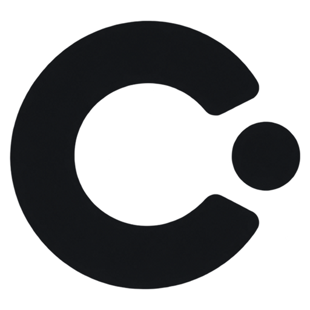

<div align="center">



# Cue

**すべてのキーストロークとジェスチャーを、ステージの中心に。**  
*プレゼンテーション、プログラミング配信、画面録画に最適な超高速・高品位なキーストローク可視化ツール。*

[](https://github.com/yviscool/cue/actions/workflows/ci.yml)
[](https://golang.org)
[-0078D6?style=flat-square&logo=windows)](https://microsoft.com/windows)
[](https://github.com/yviscool/cue/releases)
[](../LICENSE)

[English](../README.md) · [简体中文](../README_zh.md) · [繁體中文](README_zh-TW.md) · [日本語](README_ja.md)

</div>

---

## 概要

**Cue**（キュー）は、**Pure Go (Zero CGO)** と **Direct3D 11 GPU ハードウェアアクセラレーション** によってゼロから構築された、極めて軽量かつエレガントなキーストローク＆マウス可視化ツールです。

技術プレゼン、プログラミング教育、ライブ配信、動画チュートリアルにおいて、話者の操作を視聴者にストレスなく美しく伝えます。フォアグラウンドのフォーカスを一切奪わず、マウスクリックを完全に透過させながら、洗練されたステージシグナルを描画します。

---

## 主な機能と特長

- ⚡ **Pure Go ネイティブ設計 (Zero CGO)**：Windows Win32 および Direct3D 11 API に直接接続。単一の実行可能ファイル（< 12 MB）で動作し、外部 DLL や C ランタイムへの依存はありません。ミリ秒単位の超高速起動と極限の省メモリを実現。
- 🎮 **Direct3D 11 GPU レンダリング**：60Hz / 120Hz / 144Hz+ の高リフレッシュレートをサポート。ティアリングのない透明オーバーレイが、クリックスルーで滑らかに動作します。
- 🎨 **12 種類の厳選キーボードテーマ**：
  - *Liquid Glass*（visionOS 風すりガラス擬態と微光屈折）
  - *MacBook Scissor*（Apple スペースグレイ調のアルミシザースイッチ）
  - *Dieter Rams 1960*（ブラウン社のインダストリアルデザインと温かいグレー＆オレンジ）
  - *Cyberpunk Neon*（ハイコントラストなシアン＆マゼンタネオン）
  - *Classic Mechanical*（PBT ダブルショットキーキャップ）
  - *IBM Model M 1984*（クラシックな座屈バネ式メカニカル）
  - *Minimal Chalk*, *Obsidian OLED*, *Tokyo Blossom*, *Emerald Matrix*, *Sunset Horizon*, *Royal Velvet*
- 🖱️ **6 種類の専用マウステーマ (v1.1.0 新機能)**：
  - *Neon Green*、*Aurora Dual-Tone*、*Cyber Cyan*、*Obsidian Crimson*、*Deep Space Blue*、*Minimal White*
  - 左右クリックとホイールの色分け表示、カーソル周辺の波紋エフェクト。
- 🎯 **Retina マルチクリックバッジ**：
  - クリックされた物理ボタンの位置（左クリックなら左上、右クリックなら右上）に連打バッジ（`×2`、`×3`）を動的に固定配置。
  - ハイライトが消灯した後もバッジは 1.2 秒間残留し、視聴者が確実に連打を認識できます。
- 🧭 **高精度スクロール方向インジケーター**：
  - マウスホイールスロット内に高コントラストな上下方向シェブロン矢印を表示。スクロール時に連打バッジが誤反応することはありません。
- ⏱️ **ミリ秒単位のハイライト持続時間調整**：
  - 設定パネルから 20ms 刻みでクリック点灯時間を自由自在に調整可能。
- 🧠 **コンテキスト認識型ショートカット意図**：
  - `Ctrl + C`（コピー）、`Alt + Tab`（ウィンドウ切替）、`Ctrl + Z`（元に戻す）などの汎用ショートカットを自動判別し、キーキャップの下に直感的な字幕を表示。
  - 前面のアプリを検出して意味を切り替えます：**VS Code**、**JetBrains**、**Visual Studio**、**Dev-C++**、**IDLE**、ブラウザ、ターミナル、Office、Figma、Slack など。
  - 2 段階シーケンス（`Ctrl + K` `Ctrl + S` $\rightarrow$ *すべて保存*）、アプリ名バッジ、`config.json` によるカスタム上書きに対応。
  - 解析結果は前面アプリの変化ごとにキャッシュされ、フック経路はゼロアロケーションのままです。
- 🔤 **英数字のスマート単語結合＆バックスペース吸収**：
  - タイピング中の文字を自動で単語カプセルにまとめ、バックスペース入力時には末尾文字をリアルタイムにきれいに巻き戻して消去します。
- 🔊 **打鍵サウンド＆空間音響 (v1.2.0)**：
  - 高速タイピングに対応した低遅延ポリフォニックミキシングエンジンを搭載。
  - 5種類の打鍵音プロファイル：**Thock (メカニカル)**、**Click (クリッキー)**、**Scissor (パンタグラフ)**、**Glass (グラス)**、**Typewriter (タイプライター)**。テーマ連動または手動選択に対応。
  - キーの水平位置に応じたステレオパンニングとピッチ変化をサポート。
- 📍 **デュアル 9 分割スクリーン配置＆ミニマップ**：
  - 3×3 方向ボタンと 16:10 縮小ディスプレイミニマップで、直感的な画面端吸着とピクセル単位のマージン調整が可能。
- 🔒 **プライバシーシールド**：
  - パスワード入力フィールドを自動検出し、`[🔒 Private]` として安全にマスキング。
- 🌐 **4 言語リアルタイム切替**：
  - 日本語、English、简体中文、繁體中文にネイティブ対応。

---

## クイックスタート

### 1. ビルド済みバイナリのダウンロード
[GitHub Releases](https://github.com/yviscool/cue/releases) ページから最新の `cue.exe` を直接ダウンロードしてください。
インストール不要で、そのままダブルクリックして起動できます。

### 2. ソースコードからのビルド
動作要件: Go 1.23+、Windows 10/11。

```powershell
# リポジトリのクローン
git clone https://github.com/yviscool/cue.git
cd cue

# テストの実行
go test -v -count=1 ./...

# 本番向け最適化バイナリのビルド
go build -ldflags="-H windowsgui -s -w" -o cue.exe .
```

### 3. 操作とグローバルショートカット
- **オーバーレイの表示/非表示**：`Shift + F10`（設定で変更可能）。
- **設定ウィンドウの表示**：タスクトレイの Cue アイコンをクリックして設定を開きます。

---

## ライセンス

Cue は [MIT License](../LICENSE) の下で公開されているオープンソースソフトウェアです。
