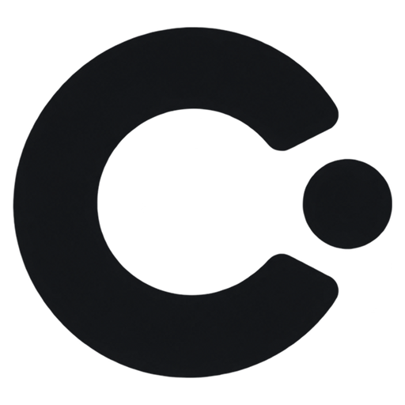

<div align="center">



# Cue

**極簡高質感按鍵與手勢舞台提示工具，讓每一次敲擊與手勢都清晰可見。**  
*專為演講演示、教學培訓、技術直播與螢幕錄製打造的高刷新、無焦點奪取視覺信號系統。*

[](https://github.com/yviscool/cue/actions/workflows/ci.yml)
[](https://golang.org)
[-0078D6?style=flat-square&logo=windows)](https://microsoft.com/windows)
[](https://github.com/yviscool/cue/releases)
[](../LICENSE)

[English](../README.md) · [简体中文](../README_zh.md) · [繁體中文](README_zh-TW.md) · [日本語](README_ja.md)

</div>

---

## 品牌理念

**Cue** —— 提示、信號、舞台提示。

在現場演講、程式教學與技術演示中，操作者行雲流水的高頻快捷鍵常常讓螢幕前的觀眾眼花繚亂。**Cue** 基於純粹的 **Pure Go (Zero CGO)** 原生架構與 **Direct3D 11 GPU 硬體加速**，以極致的視覺審美標準重新定義按鍵可視化工具。

它不奪取任何焦點，不產生任何卡頓，完全穿透滑鼠點擊，將物理敲擊與滑鼠動作化作舞台上俐落、靈動的高質感信號。

---

## 核心亮點

- ⚡ **原生 Pure Go 直驅 (Zero CGO)**：純 Go 語言直連 Windows Win32 / Direct3D 11 底層，單文件獨立運行（< 12 MB），零依賴任何外部 C 運行時或 DLL。毫秒級極速冷啟動，記憶體佔用極低。
- 🎮 **Direct3D 11 GPU 硬體渲染**：原生支援 60Hz / 120Hz / 144Hz+ 高刷新率，無撕裂、透明穿透，絕不搶占任何前台焦點。
- 🎨 **19 款官方精選大師級鍵盤主題**：
  - *液態冰晶 (Liquid Glass)*：visionOS 毛玻璃擬態微光折射
  - *深空剪刀腳 (MacBook Scissor)*：蘋果深空灰輕薄磨砂質感
  - *博朗經典 (Dieter Rams 1960)*：迪特·拉姆斯工業美學暖灰與經典安全橙
  - *賽博霓虹 (Cyberpunk Neon)*：高對比電光青紫霓虹脈衝
  - *深藍脈衝 (Azure Pulse)*：深藍底板，修飾鍵與字母鍵同色冰藍螢光
  - *經典機械 (Classic Mechanical)*：PBT 雙色注塑質感
  - *IBM Model M 1984*：復古工業屈服彈簧軸
  - *索尼經典 (Sony Walkman 1979)*：金屬銀藍與磁帶倉亞克力質感
  - *極簡粉筆 (Minimal Chalk)*、*黑曜石 OLED (Obsidian OLED)*、*東京櫻花 (Tokyo Blossom)*、*翡翠矩陣 (Emerald Matrix)*、*落日地平線 (Sunset Horizon)*、*皇家天鵝絨 (Royal Velvet)*、*合成器先鋒 (Teenage OP-1)*、*琥珀終端 (Amber Cathode 1977)*、*蘇黎世平面 (Swiss Typography 1957)*、*京都金繕 (Kyoto Kintsugi)*、*工程藍晒 (Blueprint Cyanotype)*
- 🖱️ **6 套伴侶滑鼠專屬主題 (v1.1.0 升級)**：
  - *螢光極客綠 (Neon Green)*、*極光雙色 (Aurora Dual-Tone)*、*賽博電青 (Cyber Cyan)*、*黑曜緋紅 (Obsidian Crimson)*、*深空科技藍 (Deep Space Blue)*、*純粹極簡白 (Minimal White)*
  - 左右鍵與滾輪扇區分色高亮，配合伴侶游標漣漪光環。
- 🎯 **視網膜物理連擊徽章 (Retina Multi-Click Badges)**：
  - 動態物理貼合：左鍵連擊錨定至滑鼠左上角，右鍵連擊錨定至右上角。
  - 連擊徽章與點擊高亮解耦：按鍵高亮按設定時長熄滅，而 `×2` / `×3` 徽章持續停留 1.2 秒，觀眾肉眼清晰可辨。
- 🧭 **精緻滾輪方向指示器**：
  - 高對比度方向指示箭頭與中軸膠囊槽黃金比例排布，滾動方向一目了然。
  - 滾輪滾動與點擊計數隔離，滾輪操作不誤觸發連擊徽章。
- ⏱️ **毫秒級高亮時長調節 (Click Linger Control)**：
  - 徹底解耦按鍵高亮與後台清理時序，支援在設置面板中以 20ms 為步進微調扇區與光圈停留時長。
- 🧠 **上下文智慧快捷鍵識別**：
  - 智慧識別常用組合鍵並在鍵帽下方展示操作意圖（如 `Ctrl + C` $\rightarrow$ **複製**、`Alt + Tab` $\rightarrow$ **切換視窗**、`Ctrl + Z` $\rightarrow$ **還原**）。
  - 自動識別前景應用程式並調整含義：**VS Code**、**JetBrains**、**Visual Studio**、**Dev-C++**、**IDLE**、瀏覽器、終端機、Office、Figma、Slack 等。
  - 支援雙段序列（`Ctrl + K` `Ctrl + S` $\rightarrow$ **全部儲存**）、應用程式名稱標籤，以及透過 `config.json` 自訂快速鍵。
  - 解析結果依前景應用程式變化快取，鉤子路徑零配置，幀率始終穩定。
- 🔤 **連續字母數字智能聚合與退格吸收**：
  - 自動將連續打字組合為單一單詞膠囊；按下退格鍵時自動逆向吞噬尾部字元，展示鏡像乾淨俐落。
- 🔊 **按鍵音效與空間聲相 (v1.2.0 升級)**：
  - 內建多複音即時混音音訊模組，支援高頻擊鍵平滑播放。
  - 預設 5 種按鍵音效：**Thock (機械軸)**、**Click (段落軸)**、**Scissor (剪刀腳)**、**Glass (玻璃微音)** 與 **Typewriter (打字機)**，支援與視覺主題聯動或手動指定。
  - 支援基於按鍵水平座標的雙耳立體聲聲相定位與微音高動態變化。
- 🎚️ **即時呈現控制 (v1.3.0 升級)**：
  - 按鍵浮層與滑鼠疊加層各自獨立的透明度滑桿，游標光圈可以比旁邊的鍵帽更淡。
  - 擊鍵主音量滑桿，增益在混音階段施加，拖動即時生效、無需重新渲染任何取樣。
- 📚 **快速鍵詞庫擴充**：
  - 1061 條映射，覆蓋 25+ 應用程式設定與 120 條分類預設，707 個不同動作意圖，零重複鍵位。
  - Shifted 符號規範化：`Ctrl + !`、`Ctrl + Shift + 1`、`Ctrl + Shift + Exclamation` 統一解析為同一個組合。
  - 生成的對照表位於 `docs/shortcut-reference.md`，由測試校驗。
- 📍 **雙模 9 宮格螢幕吸附定位系統**：
  - 實體 3×3 方位按鈕矩陣配合全比例微縮螢幕互動小地圖，支援精確邊距像素微調。
- 🔒 **隱私安全護盾 (Privacy Shield)**：
  - 智慧識別敏感密碼輸入，自動將私密按鍵替換為 `[🔒 Private]`。
- 🌐 **四國語言原生動態切換**：
  - 繁體中文、English、簡體中文與日本語，介面與字幕即時無縫刷新。

---

## 快速使用

### 1. 下載預編譯單文件程式
前往 [GitHub Releases](https://github.com/yviscool/cue/releases) 頁面，下載最新的獨立單文件 `cue.exe`。
免安裝、解壓即用、無任何殘留。

### 2. 從源碼構建
環境要求：Go 1.23+，Windows 10/11 系統。

```powershell
# 複製倉庫
git clone https://github.com/yviscool/cue.git
cd cue

# 執行單元測試
go test -v -count=1 ./...

# 編譯優化版 Windows GUI 獨立程式
go build -ldflags="-H windowsgui -s -w" -o cue.exe .
```

### 3. 操作與全域快捷鍵
- **顯示/隱藏懸浮窗**：按鍵盤 `Shift + F10`（支援在設置中心自訂）。
- **設置中心**：左鍵或右鍵點擊系統匣 Cue 圖示，選擇「一般設定」打開偏好設定工作台。

---

## 專題文件

- [系統架構解析 (Architecture)](architecture.md) — 了解 Pure Go Direct3D 11 渲染底座、Windows 全域低階攔截器與衰減循環狀態機。
- [完整配置指南 (Configuration)](configuration.md) — `%APPDATA%\Cue\config.json` 完整 JSON 屬性規範與修改範式。
- [主題與視覺定制 (Themes)](themes.md) — 12 套鍵盤主題與 6 套滑鼠專屬主題詳細色彩速查表。
- [快捷鍵意圖與隱私規範 (Shortcuts)](shortcuts.md) — 意圖識別規則、支援的操作詞典與密碼安全屏蔽策略。

---

## 開源協議

本專案採用 [MIT License](../LICENSE) 開源協議。
